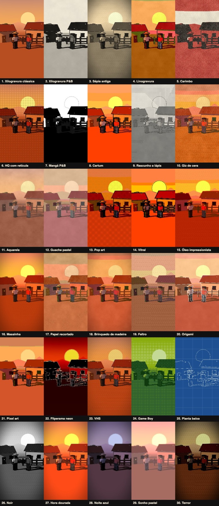
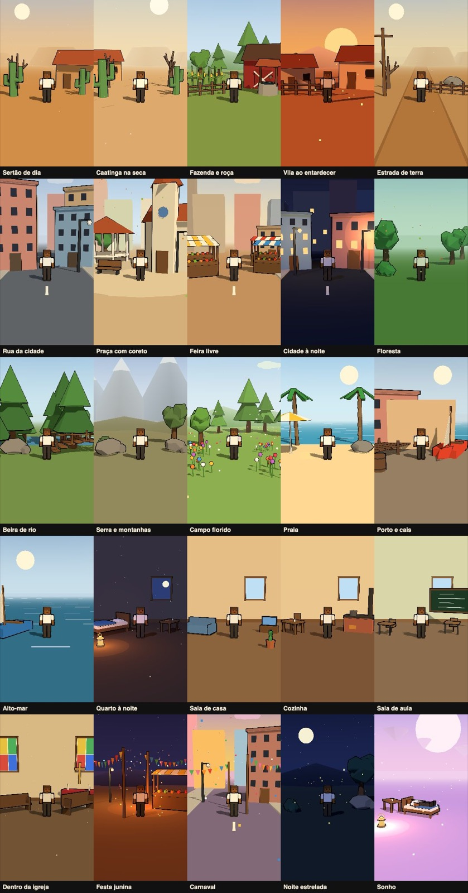
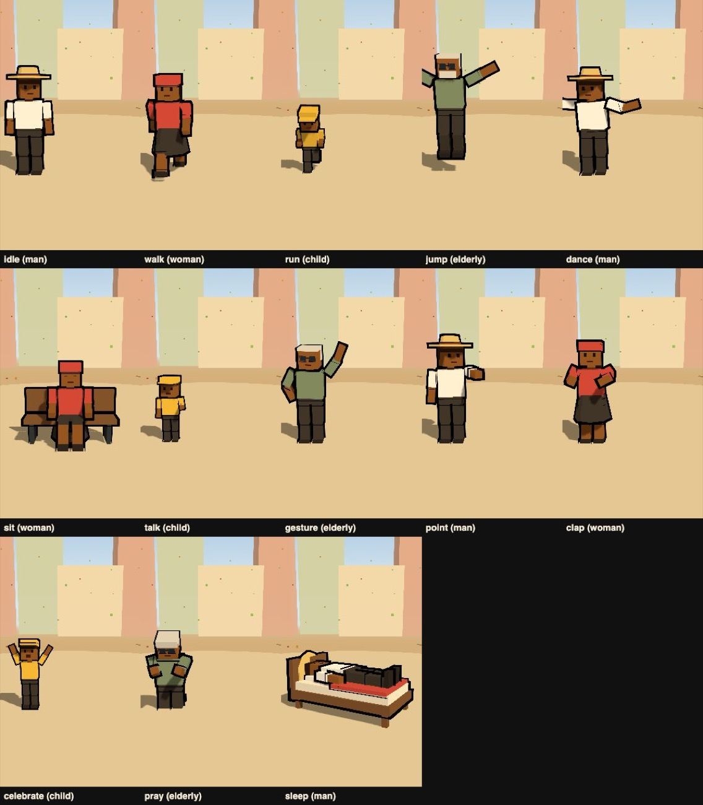
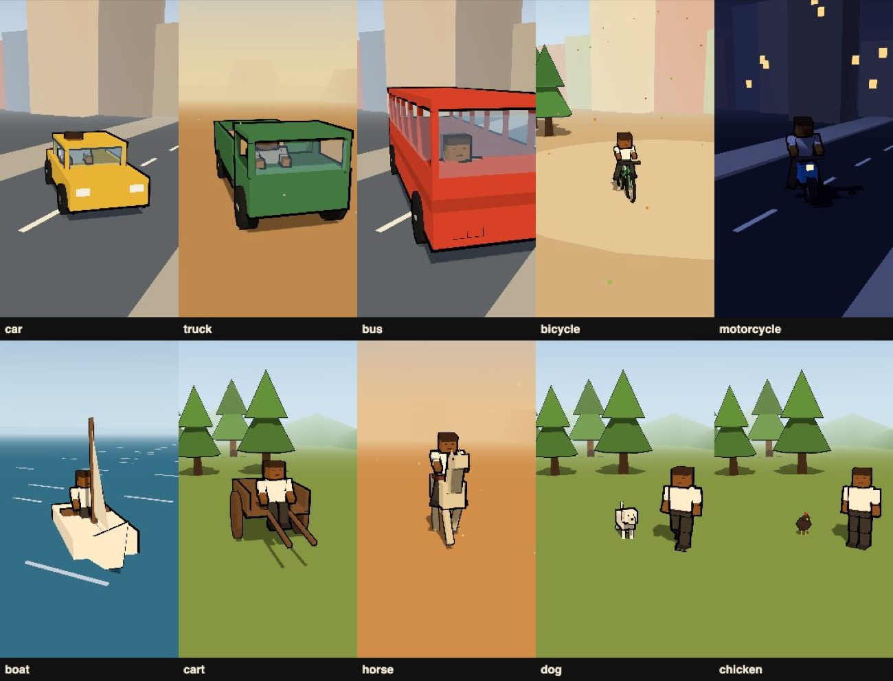
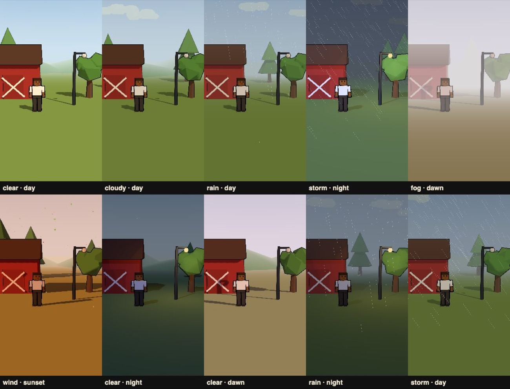
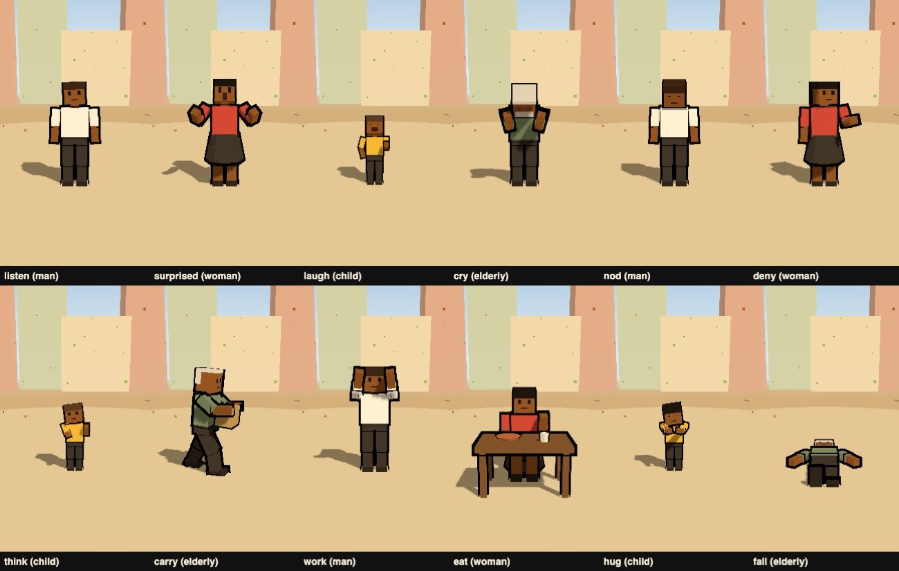
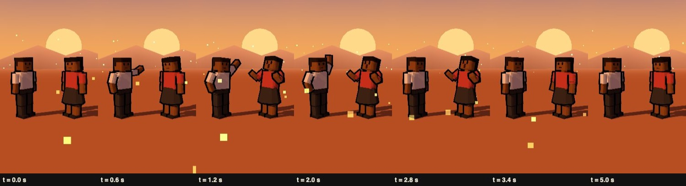

# Xilo Studio

Roteiro + narração → vídeo vertical 3D low-poly com cel-shading, legendas
karaokê e exportação automática. Three.js + LLM.

O nome vem de **xilogravura**, a arte que ilustra a literatura de cordel:
contornos pretos grossos e cores chapadas. É a estética que o motor produz
(toon shader de 3 tons + contorno por casco invertido).

> Documentação completa em [docs/](docs/README.md): arquitetura, operação, IA,
> motor 3D e histórico. Novidades de cada versão no [CHANGELOG](CHANGELOG.md).

## O que é

Uma aplicação web que roda 100% no navegador. Você entrega:

1. o texto do roteiro;
2. o áudio da narração (`.mp3` ou `.wav`).

O Xilo devolve um vídeo vertical 9:16 (1080x1920) com cenas 3D montadas só com
primitivas procedurais, câmera animada, título de localização e legenda que
destaca a palavra falada, sincronizado com a narração e pronto para exportar.

**Funciona sem nenhuma chave de API.** Com chaves, fica melhor:

| Etapa | Sem chave | Com chave |
|---|---|---|
| Tempo de cada palavra | Alinhador local | OpenAI Whisper |
| Direção de arte das cenas | Gerador por regras | OpenAI, Gemini ou Claude |

## Instalar e rodar

Requer Node.js 22.12+.

```bash
git clone https://github.com/edilsonborges/xilo-studio.git
cd xilo-studio
npm install
cp .env.example .env   # preencha ADMIN_EMAILS (e RESEND_API_KEY para enviar e-mails)
npm run dev            # servidor de contas + Vite
```

Abra `http://localhost:5173/login`. Sem `RESEND_API_KEY`, o link de senha não é
enviado; para testar o app sem login, use `npm run dev:web` (só o Vite).

Outros comandos:

```bash
npm run build      # checa os tipos (app e servidor) e gera dist/
npm test           # testes do servidor de contas
npm run check      # testes + build
npm run typecheck  # só a checagem de tipos
npm run narrar     # gera a narração com o VoiceStudio (veja abaixo)
```

## Exemplo de uso

1. Clique em **Usar exemplo** (ou cole o seu roteiro).
2. Em **Narração**, escolha a voz e clique em **Gerar narração**, ou arraste um arquivo para a área de áudio. Ouça o resultado no player.
3. Escolha o **Estilo do vídeo** e clique em **Gerar vídeo**. A prévia vertical começa a tocar com a narração.
4. Arraste a linha do tempo à vontade: o mesmo instante mostra sempre o mesmo
   frame.
5. Escolha o formato e clique em **Exportar vídeo**. O arquivo é baixado ao
   final.

Para ajustar as cenas à mão, abra **Cenas (SceneGraphJSON)**, edite o JSON e
clique em **Aplicar JSON**. Valores fora do schema são corrigidos, nunca
quebram a renderização.

Dica: sem Whisper, o alinhador local distribui as palavras do roteiro pela
duração da fala. Ele funciona melhor quando o roteiro é exatamente o texto
narrado e a narração tem ritmo regular.

## Estilos de vídeo e IA do Xilo

No passo 3 você escolhe o estilo. Os visuais 3D ficam em `src/engine/styles.ts` (material e contorno) e o pós-processamento em `src/engine/post.ts`, um shader único na GPU.

| Estilo | Como as cenas são feitas |
|---|---|
| **Ilustrado por IA** (xilogravura, aquarela, livro infantil, cinema) | A IA lê o roteiro, descreve uma imagem por cena com os mesmos personagens e desenha cada uma. O vídeo anima as imagens com movimento de câmera, título e legenda. Representa qualquer história, mas cada imagem leva de segundos a minutos. |
| **3D** (30 visuais em 6 grupos: cordel e gravura, desenho e HQ, pintura, brinquedo e material, retrô e digital, cinema e clima) | Cenas montadas com um kit de peças 3D (sertão, vila, floresta, vaqueiro…) e desenhadas no visual escolhido. Rápido, dá para trocar o visual sem gerar de novo, mas não desenha nada fora do kit. |



O conteúdo das cenas 3D fica no catálogo `src/scenarios.ts` (25 cenários com
paleta, objetos típicos, clima, hora e palavras do roteiro), em
`src/engine/scenery.ts` (objetos), `src/engine/vehicles.ts` (veículos e
animais) e `src/engine/character.ts` (tipos de personagem e 27 ações).

| Cenários | Ações | Veículos | Clima e hora |
|---|---|---|---|
|  |  |  |  |

A direção das cenas 3D pela IA do Xilo tem duas etapas (`src/director/`):

1. **Ficha da história** (`STORY_PROMPT`): elenco, tom e arco de lugares, hora e
   clima, fixos para todas as cenas.
2. **Cenas**: seguem a ficha, com dois exemplos da biblioteca
   (`examples.ts`) escolhidos pelo cenário e, ao gerar de novo, as orientações
   de variação (`variants.ts`).

Cada personagem pode ter `actions`: deixas `{ "at": palavra ou segundos, "do":
ação }` que trocam a ação no instante em que a palavra é narrada. Sem IA, o
gerador por regras cria as mesmas deixas a partir dos verbos do roteiro.

Gestos e reações tocam uma vez e o personagem volta a ficar parado (`ONE_SHOT`
em `src/engine/character.ts`); as demais ações valem a cena inteira.




A "IA do Xilo" roda no servidor, pelo [opencode-gateway](https://github.com/edilsonborges/opencode-gateway)
da mesma máquina: texto com `gpt-6-luna` e imagens com `gpt-image-2`, pela
assinatura do ChatGPT. Ninguém precisa de chave no navegador. Configure
`GATEWAY_API_KEY` no `.env` com uma chave de consumidor do gateway (perfil
`read_only`). Sem ela, ou se a imagem falhar, o Xilo faz o vídeo em 3D e avisa.
As chaves próprias (OpenAI, Gemini, Anthropic) em **Configurações** continuam
funcionando como alternativa para dirigir o 3D.

## Gerar a narração

Em **Narração**, selecione a voz e a velocidade e clique em **Gerar narração**. A voz inicial é Dora, em português brasileiro, pelo VoiceStudio com Kokoro. O app gera WAV e usa o alinhador escolhido nas configurações. As vozes do Edge geram MP3 com os tempos de cada palavra. O limite do app é de 6.000 caracteres por roteiro e 20 narrações a cada 15 minutos por pessoa. [Configuração do VoiceStudio](docs/OPERACAO.md#narração-com-voicestudio)

Os seletores de voz, velocidade e versão de áudio abrem uma grade de cartões, como o seletor de estilo do vídeo. Ouça uma amostra antes de gerar. O mesmo player toca o áudio enviado ou a versão selecionada da narração. Na prévia do vídeo, abaixo de **Legendas**, escolha entre Pílula, Cinema, Manchete, Cordel e Palavra em foco. A troca aparece na prévia e vale para a próxima exportação.

O player permite ouvir a narração antes de gerar o vídeo. Use **Regenerar narração** para criar até três versões e clique no título do player para escolher qual usar no vídeo. O histórico fica neste navegador, separado por conta. Ao gerar a quarta, você escolhe se quer substituir a mais antiga. A preferência pode ser alterada em **Configurações > Narração**.

No terminal, o comando salva a narração no diretório atual.

```bash
npm run narrar -- roteiro.txt
npm run narrar -- roteiro.txt --voz pt-BR-FranciscaNeural --saida narracao.mp3
npm run narrar -- roteiro.txt --velocidade 0.95
npm run narrar -- --vozes          # lista as vozes pt-BR
npm run narrar -- --vozes en-US    # lista as vozes de outro idioma
```

O nome de saída padrão é `narracao.wav` para VoiceStudio e `narracao.mp3` para Edge.

| Voz pt-BR | Timbre |
|---|---|
| `voicestudio-pt-br` (padrão) | Natural, Dora |
| `voicestudio-noticia` | Notícia, Alex com ritmo rápido |
| `voicestudio-conto` | Conto, Santa com ritmo pausado |
| `voicestudio-documentario` | Documentário, mistura de Dora e Alex |
| `pt-BR-AntonioNeural` | masculina |
| `pt-BR-FranciscaNeural` | feminina |
| `pt-BR-ThalitaMultilingualNeural` | feminina, multilíngue |

O servidor do Xilo e o comando de terminal usam a API da instância local do VoiceStudio. Nas vozes do Edge, o Node acessa o serviço de leitura da Microsoft.

## Chaves de API

As chaves são digitadas em **Configurações**, dentro do app. Elas ficam apenas
no `localStorage` do seu navegador e são enviadas somente para a API do
provedor escolhido. Nada vai para o repositório nem para o servidor do Xilo,
que só cuida das contas de acesso.

| Campo | Para que serve |
|---|---|
| Chave OpenAI | Whisper (timestamps por palavra) e/ou diretor de arte |
| Chave Gemini | Diretor de arte |
| Chave Anthropic | Diretor de arte |

Em Configurações você também escolhe a origem dos timestamps, o provedor do
diretor de arte, os modelos e a cor de destaque da legenda. O botão **Apagar
chaves** limpa os campos.

Observações:

- Chamar essas APIs direto do navegador expõe a chave a quem tiver acesso à
  sua máquina ou ao seu perfil do navegador. Use chaves suas, com limite de
  gasto, e não publique o app com chaves embutidas.
- A API da Anthropic é chamada pelo SDK oficial com
  `dangerouslyAllowBrowser: true`, que envia o header
  `anthropic-dangerous-direct-browser-access: true`.
- Se uma chamada falhar (chave inválida, limite, rede), o Xilo avisa e cai no
  fallback local daquela etapa.
- O `.env.example` não guarda segredos: só permite trocar os modelos padrão
  sugeridos na tela de Configurações.

## Como funciona

```
roteiro + áudio
   │
   ▼
1. Timestamps        src/audio/       Whisper ou alinhador local
   │                                  → palavras e frases com tempo
   ▼
2. Diretor de arte   src/director/    fatia em cenas de 4 a 8 s, pede o
   │                                  SceneGraphJSON ao LLM (ou às regras)
   │                                  e valida contra o schema
   ▼
3. Motor 3D          src/engine/      Three.js: toon de 3 tons, contorno,
   │                                  personagens, ambiente, props
4. Câmera e tempo                     tudo é função de currentTime
   ▼
5. Compositor        src/compositor/  Canvas 2D master: frame 3D + título
   │                                  + legenda karaokê
   ▼
   Exportador        src/export/      MediaRecorder: canvas + áudio original
```

### 1. Áudio e timestamps

- `audio/whisper.ts`: envia o áudio à OpenAI Audio API com timestamps por
  palavra e casa a transcrição com o roteiro (maior subsequência comum), para
  a legenda manter a grafia e a pontuação do roteiro com os tempos reais.
- `audio/aligner.ts`: fallback local. Detecta início e fim da fala pelo
  envelope de energia e distribui o tempo proporcionalmente ao tamanho das
  palavras, com pausas em vírgulas, pontos e quebras de linha.

### 2. Diretor de arte

- `director/splitter.ts`: corta a narração em cenas de 4 a 8 segundos,
  preferindo fim de frase, depois vírgula.
- `director/llm.ts`: prompt e chamadas a OpenAI, Gemini e Claude. Os tempos
  das cenas vêm sempre do áudio, o LLM só decide o conteúdo.
- `director/validate.ts`: normaliza qualquer JSON recebido. Enum fora da lista
  vira o valor válido mais próximo (apelidos, flexões, distância de edição) ou
  o padrão; cores e vetores inválidos caem na paleta do preset; o mesmo `id`
  de personagem mantém cores e acessório em todas as cenas.
- `director/rules.ts`: fallback sem chave. Palavras-chave do roteiro escolhem
  preset, props, animações, companhia em cena, câmera e título.

### 3 e 4. Motor, câmera e determinismo

- `engine/toon.ts`: `MeshToonMaterial` com `DataTexture` de 3 tons e
  `NearestFilter`; contorno por casco invertido (`BackSide`) com espessura
  uniforme.
- `engine/character.ts`: `createCharacter(config)`, humanoide articulado com
  `idle`, `walk`, `talk`, `sleep` e `gesture`.
- `engine/environment.ts`: `createEnvironment(preset, cores)`, com chão, céu
  em gradiente, luz direcional com sombra, luz ambiente, neblina e partículas
  (`dust`, `fireflies`, `leaves`, `rain`).
- `engine/props.ts`: `createProp(type, position, scale, color)` para os dez
  tipos do schema.
- `engine/camera.ts`: `static`, `pan_left`, `pan_right`, `zoom_in`,
  `zoom_out`, `orbit` e `follow_character`, com `easeInOut`.

Nenhuma animação acumula delta de frame. Poses, partículas, deslocamentos e
câmera são recalculados a partir do `currentTime` do áudio a cada desenho, e
tudo que é aleatório usa semente fixa. Por isso avançar ou voltar na timeline
mostra sempre o mesmo frame para o mesmo instante.

### 5. Legendas e exportação

- `compositor/compositor.ts`: desenha o canvas WebGL num canvas 2D e, por
  cima, o `locationTitle` (serifado, com fade) e a legenda no estilo escolhido.
  O seletor e o vídeo usam o mesmo desenho de `compositor/captions.ts`.
  Como tudo está no mesmo canvas, a gravação inclui a legenda.
- `export/exporter.ts`: `MediaRecorder` grava o stream do canvas master junto
  com o áudio original (`AudioContext` + `MediaStreamAudioDestinationNode`).
  O frame desenhado segue o relógio do `AudioContext`, então áudio e vídeo não
  derivam.

## Schema das cenas (SceneGraphJSON)

```json
{
  "scenes": [
    {
      "id": "scene_1",
      "startTime": 0.0,
      "endTime": 5.5,
      "locationTitle": "Bahia, anos 1930",
      "environment": {
        "preset": "sertao_day",
        "skyColor": "#e8c391",
        "groundColor": "#c28d53",
        "fogColor": "#e8c391",
        "particles": "dust"
      },
      "camera": {
        "movement": "zoom_in",
        "startPos": [0, 3, 10],
        "endPos": [0, 2.5, 7],
        "lookAt": [0, 1, 0],
        "target": "protagonist"
      },
      "characters": [
        {
          "id": "protagonist",
          "position": [0, 0, 0],
          "targetPosition": [0, 0, 3],
          "skinColor": "#8d5524",
          "shirtColor": "#f4f1ea",
          "pantsColor": "#3d352e",
          "accessory": "straw_hat",
          "animation": "walk"
        }
      ],
      "props": [
        { "type": "rustic_house", "position": [-4, 0, -3], "rotationY": 0.5, "scale": 1.0, "color": "#d9a066" },
        { "type": "dry_tree", "position": [3, 0, -2], "rotationY": 0, "scale": 1.2 }
      ]
    }
  ]
}
```

| Campo | Valores |
|---|---|
| `environment.preset` | `sertao_day`, `interior_night`, `village_sunset`, `forest` |
| `environment.particles` | `dust`, `fireflies`, `leaves`, `rain`, `none` |
| `camera.movement` | `static`, `pan_left`, `pan_right`, `zoom_in`, `zoom_out`, `orbit`, `follow_character` |
| `characters[].animation` | `idle`, `walk`, `talk`, `sleep`, `gesture` |
| `characters[].accessory` | `straw_hat`, `none` |
| `props[].type` | `rustic_house`, `bed`, `tree`, `dry_tree`, `cactus`, `table`, `lantern`, `road`, `fence`, `animal` |

- `camera.target` só vale com `follow_character` e precisa ser o `id` de um
  personagem da cena.
- `targetPosition` é opcional: com ele, o personagem vai de `position` até
  `targetPosition` ao longo da cena.
- `color` em props é opcional: sem ele, vale a paleta do preset.
- O mesmo `id` de personagem mantém cores e acessório em todas as cenas.

## Publicar (Docker + túnel do Cloudflare)

O Xilo só abre para quem tem conta. Um servidor Node (Express + SQLite) exige
login, serve o `dist/` do Vite e manda convites e links de senha pelo Resend.
O vídeo continua sendo gerado inteiro no navegador.

| Arquivo | Papel |
|---|---|
| `Dockerfile` | build com Node 22 (`npm ci` + `npm run build`) e imagem final com o servidor |
| `server/` | login, sessões, painel de usuários, CSP e `/healthz` |
| `docker-compose.yml` | serviço `xilo-studio`, exposto só em `127.0.0.1:47653`, banco no volume `xilo_data` |
| `.env` | `ADMIN_EMAILS`, `RESEND_API_KEY` e `RESEND_FROM` (copie de `.env.example`; fica fora do Git) |
| `scripts/update.sh` | atualiza, reconstrói e confere o `/healthz` |

### Contas e acesso

- Não há cadastro aberto. Quem entra é convidado por um administrador em `/admin`.
- Administradores são os e-mails de `ADMIN_EMAILS`. No primeiro acesso, use
  **Esqueci minha senha / primeiro acesso** na tela de login: o link chega por e-mail.
- O convite vale 7 dias; o link de "esqueci a senha", 1 hora. Cada link funciona
  uma vez, e pedir outro invalida o anterior.
- Remover alguém no painel derruba as sessões dessa pessoa na hora.
- Senhas são guardadas com scrypt; sessões duram 30 dias (cookie `HttpOnly`).
- Sem `RESEND_API_KEY` o login continua funcionando, mas nenhum e-mail sai.
- A chave do Resend fica só no `.env` da máquina que roda o container. Não use
  secret do GitHub para ela: o deploy é feito na própria máquina, não por Actions.

### 1. Subir o container

Na máquina que vai hospedar (com Docker e o repositório clonado):

```bash
cp .env.example .env    # preencha ADMIN_EMAILS e RESEND_API_KEY
chmod 600 .env
docker compose up -d --build
curl http://127.0.0.1:47653/healthz   # deve responder "ok"
```

A porta fica presa em `127.0.0.1` de propósito: quem expõe o app para a
internet é o túnel, não a porta da máquina.

### 2. Apontar o túnel do Cloudflare

O túnel leva um hostname público (por exemplo `xilo.seudominio.dev`) até
`http://localhost:47653`. Use o caminho que corresponde ao seu túnel.

**Túnel gerenciado pelo painel (Zero Trust):**

1. Abra Zero Trust → Networks → Tunnels e escolha o túnel da máquina.
2. Em Public Hostname, adicione um hostname.
3. Subdomínio `xilo`, domínio o seu, tipo `HTTP`, URL `localhost:47653`.
4. Salve. O Cloudflare cria o registro DNS sozinho.

**Túnel gerenciado por arquivo (`~/.cloudflared/config.yml`):**

```yaml
ingress:
  - hostname: xilo.seudominio.dev
    service: http://localhost:47653
  # ...outros hostnames...
  - service: http_status:404
```

```bash
cloudflared tunnel route dns <nome-do-tunel> xilo.seudominio.dev
# reinicie o serviço do cloudflared para ele ler o config novo
```

Se o `cloudflared` roda em container, e não direto na máquina, `localhost`
aponta para o container dele. Nesse caso use `http://host.docker.internal:47653`
ou coloque os dois serviços na mesma rede Docker.

O HTTPS do Cloudflare é necessário de qualquer forma: fora de `localhost`, o
navegador só libera gravação e áudio em página segura.

### 3. Atualizar depois

```bash
./scripts/update.sh            # última versão da main
./scripts/update.sh <commit>   # um commit específico, ou para voltar atrás
```

O script se recusa a rodar com alterações locais, reconstrói o container e
espera o `/healthz`. Se algo falhar, ele mostra o comando para voltar à versão
anterior. Defina `XILO_HEALTH_URL` se a porta local for outra.

### Sobre a CSP

O servidor envia uma Content-Security-Policy que só permite conexões para o
próprio site e para as APIs da OpenAI, do Gemini e da Anthropic. Como as chaves
ficam no `localStorage`, isso reduz o estrago se algum script indevido rodar na
página. Se você adicionar outro provedor, inclua o domínio dele em
`connect-src` no `server/app.ts`.

## Versões e entregas

A versão fica em `VERSION` (igual ao `package.json`) e aparece no topo do app.
Cada versão tem uma entrada no [CHANGELOG.md](CHANGELOG.md) e uma release no
GitHub com as mesmas notas.

Cada entrega segue: **issue → branch → testes → PR (CI verde) → merge → tag →
release → deploy**.

```bash
./scripts/check-version.sh        # versões iguais e entrada no changelog
git tag v0.1.0 && git push origin v0.1.0   # publica a release pelo GitHub Actions
./scripts/update.sh               # deploy da main nesta máquina
```

## Limitações conhecidas

- A exportação é em tempo real: um vídeo de 60 s leva 60 s. Mantenha a aba
  visível; se ela for para segundo plano, a gravação pausa e continua quando
  você voltar.
- O formato depende do navegador. Chrome e Edge recentes e o Safari gravam
  MP4 (H.264 + AAC); o Firefox grava WebM. Arquivos WebM do `MediaRecorder`
  podem sair sem duração no cabeçalho, o que atrapalha o avanço em alguns
  players; prefira MP4 quando disponível.
- A API de transcrição da OpenAI aceita arquivos de até 25 MB.
- Recomendado: navegador de desktop com WebGL 2.

## Licença

[MIT](LICENSE)
